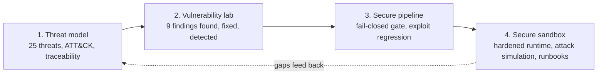

# Secure-SDLC portfolio playbook

A reproducible recipe for building a security portfolio that survives an interview where you share your screen: **one fictional
payments API carried through threat modelling, vulnerability research, a fail-closed CI gate, and a hardened runtime with detections**,
built with Claude Code and verified by commands rather than by assertion.

This repository contains the **prompts** to build it, and this README is the **walkthrough**: how it is built, how the findings
are produced, the methodologies behind it, and the tricks that make the result trustworthy. The four project repositories themselves are
generated by the prompts (or built by you, using the prompts as a spec).

> Everything is synthetic. No real company, host, IP or incident appears in the method or the outputs. Keep it that way when you adapt it.

## Contents
1. [What you end up with](#1-what-you-end-up-with)
2. [Quick start](#2-quick-start)
3. [Principles](#3-principles-that-drive-every-decision)
4. [Walkthrough, phase by phase](#4-walkthrough-phase-by-phase)
5. [The findings](#5-the-findings)
6. [Methodologies used](#6-methodologies-used)
7. [Smart tricks](#7-smart-tricks)
8. [Mistakes made and what they taught](#8-mistakes-made-and-what-they-taught)
9. [Working with Claude Code on this](#9-working-with-claude-code-on-this)
10. [Verified vs not verified](#10-verified-vs-not-verified)
11. [Adapting it and using it in interviews](#11-adapting-it-and-using-it-in-interviews)
12. [Repository layout](#12-repository-layout)

---

## 1. What you end up with

| # | Repository | Question it answers | Headline result |
|---|---|---|---|
| 1 | `payloop-threat-model` | What could go wrong, and how do I know it is covered? | 25 threats, 18 with detections, traceability validated, ATT&CK layers generated |
| 2 | `payloop-vuln-lab` | Can I find, exploit, fix and detect real flaws? | 9 findings: every exploit works on the baseline, fails on the fixed build, one patch and one PR write-up each |
| 3 | `payloop-secure-pipeline` | Can CI refuse to ship these flaws again? | Single required `gate` check, fail-closed, replays the exploits, expiring waivers |
| 4 | `payloop-secure-sandbox` | Does the hardened build hold under attack, and would the SOC see it? | 10 attack scenarios, all blocked, every expected detection fired |



The thread is the point. A threat id in repo 1 links to a finding in repo 2, a Semgrep rule or exploit test in repo 3, and a Wazuh rule
plus an attack scenario in repo 4. An interviewer can pull any thread and it holds.

## 2. Quick start

**You need:** PHP 8.1+ (`pdo_sqlite`, `sodium`), Python 3.10+ with `pyyaml`, GNU Make, Git, [Claude Code](https://docs.claude.com/en/docs/claude-code/overview).
**Optional (the build degrades gracefully and reports what it skipped):** Semgrep, gitleaks, Trivy, checkov, `actionlint`, mermaid-cli, Docker.

```bash
mkdir workspace && cd workspace
git clone https://github.com/SelikemAB/secure-sdlc-portfolio-playbook playbook
cp playbook/prompts/CLAUDE.md ./CLAUDE.md      # the standing rules Claude Code follows
claude                                          # then paste the fenced prompt from playbook/prompts/00-master-prompt.md
```

Two ways to run it:

| Mode | When | How |
|---|---|---|
| **One shot** | You want the whole thing and will review at the end | Paste `prompts/00-master-prompt.md`. It reads each phase prompt in order. |
| **Staged (recommended)** | You want to understand and defend it | Start a fresh session per phase and paste the matching `prompts/0N-*.md`. Review the diff and run the `make` targets yourself before moving on. |

Always finish with `prompts/05-verify-and-publish.md` in a **fresh** session. A system should not grade its own work.

| Prompt | Purpose |
|---|---|
| [`prompts/CLAUDE.md`](prompts/CLAUDE.md) | Standing rules: synthetic only, generated evidence, tests must be able to fail, fail closed, honest limits |
| [`prompts/00-master-prompt.md`](prompts/00-master-prompt.md) | Orchestrates all phases and the definition of done |
| [`prompts/01-threat-model.md`](prompts/01-threat-model.md) | Threat model as data plus validator and generator |
| [`prompts/02-vuln-lab.md`](prompts/02-vuln-lab.md) | App, nine flaws, exploits, patches, SAST, detections, mutation tests |
| [`prompts/03-secure-pipeline.md`](prompts/03-secure-pipeline.md) | CI gate, policy, waivers, self-protection |
| [`prompts/04-secure-sandbox.md`](prompts/04-secure-sandbox.md) | Hardened stack, attack simulator, runbooks, interview pack |
| [`prompts/05-verify-and-publish.md`](prompts/05-verify-and-publish.md) | Clean-room verification, claims audit, sanitization, packaging |

## 3. Principles that drive every decision

1. **Evidence is generated, not typed.** Every "blocked", "detected" or "exploitable" in a document comes from a command's output.
2. **A test that cannot fail proves nothing.** Exploits run against the vulnerable build (must succeed) and the fixed build (must fail). Detection suites include false-positive controls. Mutation checks break the system on purpose and require red.
3. **Fail closed.** A missing report, a crashed scanner, or an expired waiver fails the gate. A skipped tool never looks like a clean result.
4. **One source of truth, many generated views.** Threats live in one YAML file; every table, diagram and ATT&CK layer is generated, and CI fails if they are stale.
5. **Small, independent, reviewable changes.** One finding is one patch is one PR write-up, and each patch applies alone.
6. **Say what you did not verify.** Every README ends with limits. That honesty is what makes the rest believable.
7. **Zero budget.** Open-source tools only; the core demo runs on PHP's built-in server and Python.

## 4. Walkthrough, phase by phase

### Phase 0: set the rules before any code
Copy `prompts/CLAUDE.md` into the workspace. It front-loads the constraints that otherwise get violated at hour three: synthetic data only,
RFC 5737 IP ranges (`203.0.113.0/24` and friends), generated evidence, no unverifiable claims, and a task list that is only ticked off after
a verification command passes. Claude Code reads this file at the start of every session, so staged runs stay consistent.

### Phase 1: threat model as data (`payloop-threat-model`)
**Build.** Model PayLoop (clients, partners, admin, proxy, API, webhook dispatcher, CI/CD, wallet DB, receipt store, security log, SIEM) across
five trust boundaries. Write `data/threats.yaml` once: elements, flows, and 25 threats, each with STRIDE category, ATT&CK technique, likelihood
and impact (1 to 5), controls with a status, detection rule ids, tests, linked findings, and an explicit `accepted_risk` reason when a control is
absent on purpose.

**Method.** STRIDE per element on a data-flow diagram, mapped to MITRE ATT&CK, scored likelihood x impact and banded (critical >= 20, high >= 12, medium >= 6).

**Commands.**
```bash
make build     # validate, then generate docs/01..06, Navigator layers, Mermaid DFD
make check     # fail if any generated file is stale
make mutate    # break the data six ways; validation must fail every time (6/6)
```
**Output you should see:** `ok: 25 threats, 18 with detections, wrote 6 files`, then `ok: 25 threats valid, generated files up to date`, then `6/6 mutants killed`.

**Why it matters.** The risk register, the ATT&CK layer and the traceability matrix cannot drift from the model, and the model cannot claim a
detection that does not exist: the validator checks every referenced rule id against the real rule file. The 7 threats without a detection are
listed as gaps, not hidden.

### Phase 2: find, exploit, fix, detect (`payloop-vuln-lab`)
**Build the app.** PHP 8.3, no framework, SQLite, HMAC-signed stateless tokens, a JSON-lines security log. Eight routes: login, wallet, statement search,
receipt download, partner webhook test, transfer, admin users, health. Seed users alice, bob, carol, dave and admin.

**Plant nine flaws on purpose** (table in [section 5](#5-the-findings)). Then, for each one, in this order:

1. **Derive it from the threat model**, not from a scanner. Ask "which trust boundary does this input cross and what checks it?" Business-logic flaws (negative transfer amounts) only appear this way.
2. **Write the exploit first** in `tests/lab.py`. A finding without a failing-then-working exploit stays "unconfirmed".
3. **Write the fix as a minimal diff** against the baseline and keep it in `patches/Fn-*.patch`.
4. **Ask for the bypasses** (see [section 9](#9-working-with-claude-code-on-this)) and turn each into a test row.
5. **Write the detection**: Wazuh rule, MITRE-tagged, and a replayable sample.
6. **Generate the write-up** from metadata plus the lab's real output.

**Commands.**
```bash
make baseline   # every exploit against the vulnerable app: expect 9 VULNERABLE
make fixed      # build fixed tree from patches, same exploits: expect 9 MITIGATED
make matrix     # each patch applied ALONE onto a fresh baseline: expect 9/9
make ssrf       # table-driven SSRF guard bypass cases
make sast       # custom Semgrep taint rules: must be quiet on the fixed tree
make detect     # 21 detection cases, including false-positive controls
make mutate     # 6/6 broken rule sets must turn the suite red
```

### Phase 3: make CI refuse to regress (`payloop-secure-pipeline`)
**Build.** A GitHub Actions design where scanners only produce evidence and **one** job, `gate`, decides. Jobs: gitleaks, Semgrep, Trivy (fs and image),
checkov, Syft SBOM, exploit regression (the Phase 2 exploits, replayed), detection CI, then `gate` with `if: always()`.

**The policy file, not the workflow, holds the rules**: thresholds, which checkov checks block versus warn, required reports, and waiver rules
(owner, reason, expiry within 90 days). `tools/gate.py` returns 0 pass, 1 policy failure, 2 missing or unparseable required report.

**Commands.**
```bash
make test            # unit tests on real scanner output (14 tests), rule CI, exploit regression
make gate-demo-good  # clean tree: PASS (marked INCOMPLETE if scanners were absent, naming which)
make gate-demo-bad   # intentionally bad sample app and container: FAIL
make mutate          # break the gate itself; its tests must catch it (6/6)
```
Sample verdict from a machine without gitleaks and Trivy: `Verdict: PASS [INCOMPLETE: skipped gitleaks, trivy-fs, trivy-image; not equivalent to a full run]`.
A skipped scanner is shown in the verdict instead of quietly becoming a pass.

### Phase 4: harden, attack, detect, respond (`payloop-secure-sandbox`)
**Build.** The fixed app plus database constraints as the last line of defence (`CHECK(balance_minor >= 0)`, `CHECK(amount_minor > 0)`, a foreign key
on the destination wallet), a hardened container stack (non-root, read-only filesystem, `cap_drop: ALL`, `no-new-privileges`, nginx rate limiting and
security headers), 29 Wazuh rules, and an attack simulator.

**The attack simulator** fires ten scenarios of real requests, replays the app's own log through the rules, and prints the outcome:

| ID | Scenario | ATT&CK | Result | HTTP outcomes | Rules fired | Max level |
|---|---|---|---|---|---|---|
| S1 | Password spraying | T1110 | blocked | 401 x10 | 110101, 110111 | 10 |
| S2 | Brute force on one account | T1110 | blocked | 401 x5, 429 x7 | 110101, 110103, 110113 | 10 |
| S3 | SQL injection (UNION) | T1190 | blocked | 200 | 110120 | 10 |
| S4 | Path traversal | T1190 | blocked | 404 | 110121, 110122 | 10 |
| S5 | SSRF (loopback, metadata, file://) | T1190 / T1552.005 | blocked | 400 x3 | 110130 | 10 |
| S6 | IDOR enumeration of wallets | T1213 | blocked | 404 x6 | 110105, 110141 | 9 |
| S7 | Transfer from another customer's wallet | T1657 | blocked | 404 x3 | 110105, 110141 | 9 |
| S8 | Negative and zero transfer amounts | T1657 | blocked | 422 x2 | 110153 | 10 |
| S9 | Replayed payment request | T1657 | blocked | 201, 200 | 110152 | 5 |
| S10 | Forged admin token (old leaked secret) | T1606 | blocked | 401 x6 | 110160, 110161 | 11 |

```bash
make demo     # run all ten, print the table, refresh docs/demo-output.md and the README table
make test     # exploit regression, SSRF guard, detection suite, simulation
make mutate   # 6/6
make run      # start the app on http://127.0.0.1:8080
```
Also written here: seven runbooks (triage questions, queries, containment, false positives, escalation), a 3 to 5 minute demo script, and an interview Q&A.

### Phase 5: verify as a skeptic, then package
Run `prompts/05-verify-and-publish.md` in a **fresh** session: clean-room re-run of every target, `actionlint` on every workflow, render every Mermaid
block, a **claims audit** (every sentence that asserts a result must map to a command and match fresh output), a sanitization scan, and then the
top-level README, interview playbook and publishing checklist.

## 5. The findings

Scope: the PayLoop API. Method: threat-model-driven manual review of every handler, custom Semgrep rules, and one scripted exploit per finding.
Severity is qualitative (impact x ease of exploitation), deliberately not CVSS.

| ID | Severity | Finding | CWE | OWASP 2021 | Fix in one line | Wazuh | SAST sees it? |
|---|---|---|---|---|---|---|---|
| F1 | Critical | SQL injection in statement search | 89 | A03 Injection | prepared statements, escape LIKE wildcards, cap length | 110120 | yes |
| F6 | Critical | Hard-coded token signing secret | 798 | A02 Crypto failures | secret from env, fail closed if missing, rotate | 110160, 110161 | yes |
| F2 | High | IDOR on wallet lookup | 639 | A01 Broken access control | one shared ownership guard, 404 on denial, log it | 110140, 110141 | **no** (logic) |
| F3 | High | Path traversal in receipt download | 22 | A01 Broken access control | filename allow-list plus `realpath` containment | 110121, 110122 | yes |
| F4 | High | SSRF in partner webhook test | 918 | A10 SSRF | scheme allow-list, resolve every address, reject non-public ranges | 110130 to 110132 | yes |
| F8 | High | Transfer integrity: negative amount, overdraft, replay | 840 | A04 Insecure design | validate amounts, ownership, idempotency key, `BEGIN IMMEDIATE` | 110150 to 110153 | **no** (logic) |
| F5 | Medium | Unsalted MD5 password storage | 328 | A02 Crypto failures | Argon2id, rehash on login | n/a (storage) | yes |
| F7 | Medium | No login throttling, user enumeration | 307 | A07 Auth failures | throttle with 429, identical errors, dummy-hash timing | 110101 to 110113 | **no** (logic) |
| F9 | Low | Stack traces returned to clients | 209 | A05 Misconfiguration | generic body with request id, details only in the log | 110123, 110124 | yes |

**What the patch does not fix** (kept in `docs/REMEDIATION-NOTES.md`, and worth saying in interviews): treat the committed secret as compromised and rotate it;
migrate existing MD5 hashes on next login; add network egress filtering so SSRF is contained even if the guard regresses; run the app with a least-privilege
database account; add nightly ledger reconciliation because detections fire after money moved.

**Which findings a scanner can and cannot find.** Semgrep covers 6 of 9. F2, F7 and F8 are logic flaws found only by reading handlers against the
intended access-control and business rules. The write-up says so, because "my tool found everything" is the answer interviewers distrust.

**Detection blind spots are documented per finding.** Example: the SQLi rule is a regex over the query string, so it misses payloads in JSON bodies and heavily
encoded forms; the finding says to pair it with database audit logging and a WAF.

## 6. Methodologies used

| Methodology | Where | How it is applied |
|---|---|---|
| **STRIDE per element** | Phase 1 | Each external entity, process and store is walked through the six categories on a data-flow diagram with trust boundaries |
| **MITRE ATT&CK mapping** | Phases 1 and 4 | Every threat and every rule carries technique ids; Navigator layers are generated, never hand-coloured |
| **Likelihood x impact scoring** | Phase 1 | 1 to 5 each, banded, risk register generated and sorted |
| **Threat-model-driven code review** | Phase 2 | Handlers are reviewed against the access-control matrix, which is how logic flaws are found |
| **Exploit-first verification** | Phase 2 | No finding without a scripted exploit; the same script proves the fix |
| **Patch-as-diff, one finding per patch** | Phase 2 | Patches apply alone (matrix test), map to PR branches, carry a write-up |
| **Taint-mode SAST with custom rules** | Phase 2 | Source (request input) to sink (SQL, filesystem, HTTP client) rules, tuned to the codebase |
| **Detection-as-code** | Phases 2 and 4 | Rules in version control, linted, replay-tested, MITRE-tagged, run in CI |
| **Mutation testing of detections and gate** | All phases | Deliberate breakage must turn the suite red |
| **Fail-closed policy gate** | Phase 3 | One decision point, missing evidence is a failure |
| **Defence in depth across the SDLC** | Phase 4 | Design (threat model), code (guards), test (regression), deploy (container hardening, DB constraints), operate (logs, rules), respond (runbooks) |
| **Assume breach, detect anyway** | Phase 4 | Attacks run against the *fixed* build; blocked attempts still must alert |
| **AI-assisted review with verification** | Phase 2 | Model widens coverage and drafts fixes; an exploit decides what is true |

## 7. Smart tricks

**Evidence and documentation**
1. **Generate the findings document from running exploits.** `findings.yaml` holds metadata; `tests/lab.py` produces the baseline-vs-patched evidence; `gen_docs.py` merges them. Nobody can hand-edit a result into the report.
2. **Marker-embedded README tables.** `<!-- demo:start -->` / `<!-- demo:end -->` plus a 15-line script copies the generated simulation table into the README after every `make demo`. The README cannot disagree with the code.
3. **Render Mermaid in CI.** `check_diagrams.sh` extracts every diagram and renders it with mermaid-cli, so a broken diagram fails the build instead of showing an error box on GitHub. It accepts `CHROME_PATH` for machines that already have Chromium.
4. **Staleness gate.** `build.py --check` regenerates in memory and diffs against the committed docs.

**Testing the tests**
5. **Run every exploit twice.** `--expect vulnerable` on the baseline, `--expect mitigated` on the fix. If the exploit passes in both directions it is a broken exploit.
6. **Patch matrix.** Apply each patch alone to a fresh baseline. This caught F7 secretly depending on a helper introduced by F5; the helper moved into F7's patch.
7. **Mutation checks for detections.** Raise a threshold from 8 to 80, loosen a regex to match everything, move a rule to a sibling position, rename the event a rule keys on, drop a `same_field` condition, make an escalation unreachable. All six must be killed.
8. **False-positive controls in the same suite.** `expect_absent` and `max_level` encode "same wallet viewed eight times is not enumeration" and "an ordinary customer day never exceeds level 5".
9. **Replay real captured logs.** Run the exploits against baseline and fixed, save both logs, and assert the alert sets *differ* in the right way (baseline shows successful SSRF and accepted negative transfers; fixed shows blocks and denials).
10. **Convert every bypass idea into a table row.** The SSRF guard test is data-driven. Asking "how would you bypass this?" after the first fix found `::ffff:127.0.0.1` getting past the guard.

**Detection engineering**
11. **Offline rule simulator.** A deterministic subset of the Wazuh engine runs in milliseconds in CI and pre-commit. Its known differences from the real engine (timeframes use the event timestamp; descendants count toward ancestors) are documented, and `wazuh-logtest` stays the final authority.
12. **Know the sibling-rule trap.** Rules at the same level under one parent are first-match. A "negative amount accepted" rule never fired because a sibling matched first; it became a child of the transfer rule. The simulator's semantics were fixed to match.
13. **Log the *attempt*, not just the success.** Blocked transfers with zero or negative amounts get their own rule (110153). A blocked attack is still reconnaissance.
14. **Tune with `different_field`.** Spraying and enumeration are "many distinct values from one source", not "many events". `different_field` on username or wallet id separates them from a user retrying or refreshing.

**Application security**
15. **Dummy-hash verification** for unknown users makes failed logins take the same time as known users, closing the timing side of enumeration.
16. **404, not 403,** for objects you do not own, so existence is not revealed; the denial is still logged and counted by a rule.
17. **Idempotency key plus `BEGIN IMMEDIATE`** makes retries safe and prevents two concurrent transfers from both reading the old balance. A database `CHECK` constraint is the backstop if application code ever regresses.
18. **Scheme check before host check** in the SSRF guard, then resolve every A and AAAA record and require a public IPv4. `file://` and exotic schemes die before DNS is touched.
19. **Secret handling that fails closed.** If the token secret is missing or short, the app refuses to start. A default is how the original flaw happened.

**Pipeline**
20. **Scanners gather, the gate decides.** Swapping a scanner never changes branch protection because only `gate` is required.
21. **`if: always()` plus `needs` verification.** The gate runs even when a scanner job crashed and refuses to pass unless every upstream job succeeded.
22. **Expiring waivers.** Owner, reason, and an expiry within 90 days; an expired waiver fails the build until it is fixed or re-justified.
23. **The gate protects itself.** CODEOWNERS covers the policy, the gate, workflows and detections, otherwise a PR could weaken the rules it is judged by.
24. **Samples are excluded from scans but used by tests.** The deliberately bad app and Dockerfile prove the gate fails when it should without polluting real results.
25. **Least privilege in workflows.** `permissions: contents: read`, `persist-credentials: false`, no `pull_request_target`, untrusted values passed through `env` instead of interpolated into shell.

**Attack simulation design**
26. **Scenarios must be independent.** The brute-force scenario locked out a user that a later scenario needed. It now targets a dedicated account (`dave`). The accidental lockout also surfaced a real design trade-off (a per-user throttle can be abused to lock a victim out), recorded as an accepted risk.

## 8. Mistakes made and what they taught

| What went wrong | Fix | Lesson |
|---|---|---|
| F7's patch silently depended on F5's hash helper | Moved the dummy hash into F7 and regenerated patches | Patch independence needs a test (the matrix), not an assumption |
| Semgrep flagged the fixed tree | Used a prepared statement in the transfer handler; narrowed the F9 rule with `pattern-inside` | A SAST rule that cries wolf on the fix is a bad rule |
| Rule 110150 never fired | Restructured as a child rule and fixed the simulator's first-match semantics | Rule ordering is behaviour; test it |
| SSRF guard accepted `::ffff:127.0.0.1` | IPv4-only `isPublic`, scheme before host | The bypass review step paid for itself |
| Test asserted the wrong number of blockers | Fixed the assertion (7 blockers plus 3 warnings) | Count assertions are the first thing to rot |
| mermaid-cli could not find Chrome; shell quoting broke the config | `CHROME_PATH` support and `printf` for the puppeteer config | Tooling paths differ per machine; make them configurable |
| Pipeline repo was missing a test helper | Copied `ssrf_guard_test.php` in | Run each repo from a clean extract, always |
| Brute-force scenario broke a later login with 429 | Dedicated target account | Simulations need isolated state |
| README claimed a "commit story" and first-person experience that did not exist | Neutralised the wording; shipped the mutation checks as runnable targets | Never write claims the repo cannot back up |
| Model downloads were blocked by the sandbox proxy | Used frame and caption reading instead | Do not route around a policy block; adapt the method |

## 9. Working with Claude Code on this

**Prompt patterns that earned their keep**

- *Scope the model's job.* Give it one handler at a time plus the access-control matrix from the threat model.
  ```text
  You are reviewing one PHP handler for a payments API. Context: <access-control matrix>.
  List vulnerabilities with CWE, a one-line exploit, and severity. Then list the assumptions you made and what you could not check.
  ```
- *Ask for bypasses after every fix.*
  ```text
  Here is the exploit that proves finding F4 and the current patch. List ways the patch can still be bypassed
  (redirects, DNS rebinding, encoding tricks, IPv6, parser differentials). Output each as a testable case.
  ```
- *Make "done" a command.* "A phase is done only when its Makefile targets pass from a clean checkout" removes the model's chance to declare victory early.
- *Forbid weakening tests.* "Fix root causes, never weaken a test" in `CLAUDE.md` stops the easiest bad shortcut.
- *Force an uncertainty list.* "List what you could not verify" produced the honest-limits sections.

**Verification loop for AI output:** reproduce before believing; verify mechanically (patch applies, exploit now fails, other exploits unaffected, SAST quiet);
review the diff as a human PR (scope creep, swallowed errors, secrets in logs, "fixes" that only move the bug, such as stripping `../` instead of validating the path);
keep the prompt, the claim, your verdict and the evidence next to the PR.

**Where the model was weakest:** business logic. Nothing flagged negative transfer amounts until they were derived from the threat model. Expect to supply the intended rules yourself.

**Practical tips**
- Build in stages (outline, then sections); long one-shot generations lose detail.
- Run each phase in a fresh session so context is not spent on earlier phases; `CLAUDE.md` carries the rules.
- Keep the vulnerable baseline and fixed tree as the only copies of the app; later phases copy the fixed tree rather than re-deriving it.
- Have a separate session do the Phase 5 audit. A model that wrote the repo will rationalise its gaps.

## 10. Verified vs not verified

The reference portfolio this playbook was distilled from was verified as follows.

| Verified by running it | Not verified |
|---|---|
| All 9 exploits on baseline and fixed; patch matrix 9/9; 25 SSRF guard cases; 21 detection cases; 10 attack scenarios; 4 mutation suites (24 of 24 mutants killed); 14 gate unit tests; threat-model validation and staleness check; Mermaid rendering; `actionlint` on 5 workflows | Wazuh rules on a live manager (offline simulator only) |
| Clean-directory unpack of the packaged archive, then `make test`, `make mutate` and the patch matrix | GitHub Actions actually running; the Docker image and compose stack (no container runtime available); Semgrep covers 6 of 9 findings by nature |
| | **The prompts in this repository have not been replayed end to end from an empty directory.** They are a faithful distillation of the build that was done, with the lessons above folded in. Treat your first run as the test of the prompts, and fix them where it differs. |

## 11. Adapting it and using it in interviews

**Adapt**
- Swap the app: keep the nine-finding structure but use your stack (Node, Python, Go). Keep the exploit-first loop and the baseline/fixed pair.
- Swap the SIEM: the simulator idea ports to Sigma rules, Elastic detections or Splunk searches; keep replay, controls and mutation.
- Grow the model: add MFA, signed partner callbacks and TLS (recorded as open items), then close them with a new finding and a new rule.
- Next hardening steps: pin actions by commit SHA and the base image by digest, sign images with cosign and attach the SBOM as an attestation, scheduled Grype scans, ZAP baseline against the compose stack.

**Interview use**
- Claim only what you did. Before an interview, rebuild one finding (F1 or F4) yourself without reading the patch.
- 60-second pitch: "I built one fictional payments API and secured it end to end: threat model, nine exploited and fixed flaws, a fail-closed CI gate that replays the exploits, then ten attacks against the hardened build showing which my detections caught. I can also tell you what I did not verify."
- Pull threads on demand: "how do you know your detections work?" opens the mutation check; "how do you stop it recurring?" opens the gate and its policy; "walk me through a threat model" opens the YAML and its generated risk register.
- Your weakest point is your best answer: the not-verified table, stated plainly, with the next step you would take.

**Before publishing:** replace placeholder names and handles, keep every identifier synthetic, run the sanitization scan in `prompts/05-verify-and-publish.md` with your own employer and product terms,
enable branch protection with `gate` as the only required check, run the workflows once on GitHub and fix what differs, and update each README's limits as you close them.

## 12. Repository layout

```text
secure-sdlc-portfolio-playbook/
  README.md                       this walkthrough
  LICENSE
  prompts/
    CLAUDE.md                     standing rules; copy to the workspace root
    00-master-prompt.md           one-shot orchestration prompt
    01-threat-model.md            phase 1 specification
    02-vuln-lab.md                phase 2 specification
    03-secure-pipeline.md         phase 3 specification
    04-secure-sandbox.md          phase 4 specification
    05-verify-and-publish.md      clean-room verification, claims audit, sanitization, packaging
```
